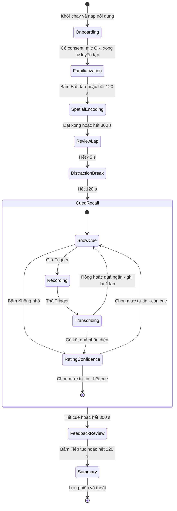
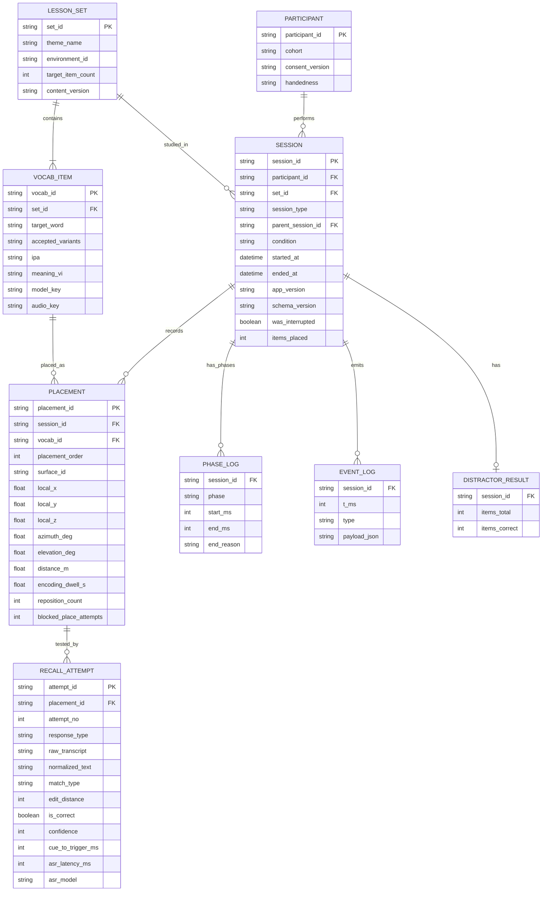

# MVP & Phân tích thiết kế hệ thống — VR Vocabulary Memory Palace (Meta Quest 3S)

## 3. MVP mới (v2)

### 3.1 Định vị và mục tiêu

- **Định vị:** ứng dụng độc lập, offline-first trên Quest 3S — vừa là công cụ học từ vựng bằng cung điện ký ức, vừa là công cụ thu dữ liệu học tập. Bối cảnh MVP là một **phòng thí nghiệm hóa học (Chemistry Laboratory)**, nơi người học **tự do đặt** 15 dụng cụ lab vào bất kỳ vị trí nào họ muốn. Chưa dùng chữ “platform” cho tới khi có backend/dashboard.
- **MVP phải trả lời 3 câu hỏi:** (1) người dùng có hoàn thành một phiên 18–21 phút ổn định và thoải mái không? (2) nhận diện giọng nói có đủ tin cậy để làm kênh trả lời không? (3) dữ liệu thu được có đủ để tính accuracy, calibration và retention không?
- **Giả thuyết nghiên cứu (điều khiển bằng cấu hình):** H1 — người học tự đặt vật nhớ tốt hơn khi hệ thống đặt sẵn cùng bộ từ; H2 — còn nhớ sau 24–48 giờ; H3 — các mục “sai với độ tự tin cao” ở lượt 1 được sửa đúng nhiều hơn ở retest (hypercorrection).

### 3.2 Phạm vi

| Trong MVP | Ngoài MVP (để sau) |
| --- | --- |
| 1 chủ đề (Chemistry Laboratory — phòng thí nghiệm hóa học), 1 phòng, 15 danh từ cụ thể là dụng cụ/vật thể trong phòng lab | Nhiều chủ đề; UC7 công cụ đóng gói nội dung cho giảng viên |
| Luồng 8 bước (pha 0–7, mục 3.3) có Onboarding, Review lap, Phản hồi & ôn lại | Dashboard, cloud, đồng bộ dữ liệu |
| ASR cục bộ qua lớp trừu tượng, cue tuần tự, nút “Không nhớ” | Chấm phát âm theo âm vị |
| Tự tin 4 mức, hỏi trước phản hồi | Eye tracking (Quest 3S không có), hand tracking |
| Retest 24–48 giờ, JSON/JSONL, script CSV | Từ trừu tượng, đa ngôn ngữ, nhiều người cùng học |

### 3.3 Luồng phiên mới

| Pha | Thời lượng | Nội dung | So với bản cũ |
| --- | --- | --- | --- |
| 0. Onboarding | 2–3 phút (lần đầu) | Consent, kiểm tra mic, tay thuận, đứng/ngồi, 1 từ luyện tập không tính điểm | **Mới** (A7, B4) |
| 1. Làm quen | ≤ 2 phút | Xem 15 từ, nghe mẫu, đánh dấu từ đã biết (pre-test) | Thêm giới hạn thời gian và pre-test (A3) |
| 2. Mã hóa không gian | ≤ 5 phút | Chọn ô → ghost → đặt tự do mọi nơi; Undo; cấm đặt hai vật quá sát; ghi dwell | Thêm Undo, đặt tự do (B3, B6) |
| 3. Review lap | 45–60 giây | Xoay quan sát các vật đã đặt; nhãn từ hiện khi nhìn vào vật | **Mới** (A6) |
| 4. Nghỉ gây nhiễu | 2 phút | Trừ lùi 3 trên bảng số 2D | Chuẩn hóa nhiệm vụ (A7) |
| 5. Truy xuất có cue | ≤ 5 phút | Cue sáng tuần tự; giữ Trigger để nói; tự tin trước phản hồi; nút “Không nhớ” | Thay đổi lớn (A4, A5) |
| 6. Phản hồi và ôn lại | 90–120 giây | Đáp án + vật + audio tại vị trí cũ; ưu tiên sai với độ tự tin cao | **Mới** (A2) |
| 7. Tổng kết và lưu | ≤ 1 phút | Accuracy, calibration, danh sách từ; ghi JSON | Mở rộng |
| Retest | ≤ 6 phút, sau 24–48 giờ | Dựng lại phòng từ dữ liệu cũ, truy xuất như pha 5 | **Mới** (A3) |

Tổng thời lượng tối đa khoảng 21 phút ở lần đầu (có onboarding) và khoảng 18 phút ở các lần sau.

### 3.4 Yêu cầu chức năng

Ưu tiên: M = Must, S = Should. Mã trong ngoặc là mục đánh giá ở 2.2 mà yêu cầu này giải quyết.

| ID | Yêu cầu | Tiêu chí chấp nhận |
| --- | --- | --- |
| FR1 (M) Học liệu | 1 bộ 15 danh từ dụng cụ phòng lab hóa học (ví dụ: beaker, test tube, flask, Bunsen burner, pipette, funnel, thermometer, crucible, tongs, goggles…); mỗi mục có từ, IPA, nghĩa tiếng Việt, audio, mô hình 3D, icon 2D và `accepted_variants`; `target_item_count` cấu hình 12–21 (A6, A7). | Công cụ kiểm tra lúc build báo lỗi nếu thiếu thuộc tính; nạp bộ từ ≤ 3 giây. |
| FR2 (M) Kho đồ và xem trước | Lưới icon 2D; chọn ô sẽ hiện từ/IPA/nghĩa và phát audio; chỉ preview 3D cho ô đang chọn; chọn bằng tia (B6). | Một preview 3D tại một thời điểm; ô đã đặt bị khóa nhưng vẫn Undo được. |
| FR3 (M) Đặt vật (mã hóa) | Ghost preview theo tia; **đặt tự do trên bất kỳ bề mặt hợp lệ nào, không ép vị trí hay lưới**; **cấm đặt hai vật sát nhau dưới khoảng cách tối thiểu** (ghost đỏ, Trigger không đặt được); Undo/đổi chỗ; ghi vị trí và dwell (B3, B6, C4). | Đặt được lên mọi bề mặt hợp lệ (bàn thí nghiệm, kệ, tủ hút, giá ống nghiệm, sàn, tường), không giới hạn vùng; **khoảng cách tối thiểu giữa hai vật 0,4 m (cấu hình) — vi phạm thì chặn đặt**; tầm tia ≤ 6 m; Undo trong 10 giây; ghi `surface_id`, tọa độ local, góc cực, `encoding_dwell_s` và `blocked_place_attempts` (số lần bị chặn vì quá sát). |
| FR4 (M) Điều phối phiên | Máy trạng thái ở mục 4.3 có Interrupted; timer tự pause khi tháo kính; thời lượng từng pha cấu hình được (B4). | Tháo/đeo kính giữa pha không làm sai timer; phục hồi đúng trạng thái; autosave sau mỗi sự kiện. |
| FR5 (M) Truy xuất bằng giọng nói | Cue sáng lần lượt (ngẫu nhiên có seed); giữ Trigger để nói; nút “Không nhớ”; ghi lại tối đa 1 lần; ASR qua `ISpeechRecognizer` (A1, A4, B1, B2). | Clip ≤ 4 giây; log `raw_transcript`, `normalized_text`, `match_type`, `asr_latency_ms`; không hiện đúng/sai ở pha này. |
| FR6 (M) Tự tin và hiệu chỉnh | Thang 1–4 có nhãn, hỏi ngay sau khi nói và trước mọi phản hồi (A5). | Mỗi lần thử có `confidence`; màn hình tổng kết hiển thị calibration (tự tin so với đúng). |
| FR7 (M) Phản hồi và ôn lại | Với mỗi mục sai/không nhớ: dựng lại vật ở vị trí cũ + từ đúng + audio; mục sai với độ tự tin cao hiển thị trước (A2). | 100% mục sai/không nhớ được xem lại; log thời gian xem. |
| FR8 (M) Ghi và xuất dữ liệu | JSON phiên (lược đồ có phiên bản) + JSONL sự kiện ghi nối đuôi; không lưu audio thô (C1–C5). | Tệp đặt tên `{participant}_{session}_{timestamp}`; lấy bằng adb; script Python đổi ra CSV; metrics tính lại từ log khớp snapshot. |
| FR9 (S) Retest | Nạp placement của phiên trước, dựng lại phòng, truy xuất 5 phút; `session_type = delayed` (A3). | Chạy được với ≥ 8 người sau 24–48 giờ. |
| FR10 (M) Onboarding và cài đặt | Consent, kiểm tra mic có chỉ báo mức âm, tay thuận, đứng/ngồi, snap-turn, 1 từ luyện tập (B5, D1). | Phiên không bắt đầu nếu chưa có consent và quyền mic. |
| FR11 (S) Cấu hình thí nghiệm | Tệp JSON: số từ, thời lượng pha, `condition` (`learner_placed` / `pre_placed`), seed (A3). | Đổi condition không cần build lại. |

### 3.5 Yêu cầu phi chức năng

Các ngưỡng dưới đây là đề xuất khởi điểm, cần hiệu chỉnh sau spike và pilot (D2).

| Nhóm | Chỉ tiêu | Cách đo |
| --- | --- | --- |
| Khung hình | Frame time p95 ≤ 13,9 ms ở 72 Hz (11,1 ms ở 90 Hz); không rớt quá 3 khung liên tiếp, kể cả khi ASR đang chạy | OVR Metrics Tool, ≥ 10 phiên thử |
| Độ trễ ASR | p50 ≤ 700 ms, p95 ≤ 1,2 giây cho clip ≤ 3 giây; giữ mục tiêu < 500 ms nếu spike đạt | `asr_latency_ms` trong spike và pilot |
| Độ chính xác nhận diện | Chấp nhận đúng ≥ 90% khi nói đúng; chấp nhận nhầm ≤ 5% | ≥ 10 người Việt × 15 từ × 2 lần, đối chiếu nhãn do người nghe gán |
| Thoải mái | FMS (0–20) trung vị ≤ 5 sau mỗi pha; ≥ 90% hoàn thành phiên | FMS sau mỗi pha, SSQ trước/sau |
| Khả dụng | SUS ≥ 68 | SUS sau phiên |
| Độ tin cậy | 20/20 phiên liên tiếp không crash; mất tối đa 1 lần thử khi gián đoạn | Soak test |
| Riêng tư | Không lưu audio thô; mã người tham gia ẩn danh; consent trước khi thu dữ liệu | Checklist review |
| Tài nguyên | Mô hình ASR ≤ 150 MB; chạy ổn định ≥ 30 phút liên tục | Soak test, log pin/nhiệt |

### 3.6 Chỉ số học tập (định nghĩa chuẩn)

| Chỉ số | Công thức | Ý nghĩa |
| --- | --- | --- |
| `accuracy` | đúng / `target_item_count` | Từ chưa đặt tính là sai, báo riêng `not_placed` |
| `retention` | (đúng ở cả hai lượt) / (đúng ở lượt đầu) | Giữ lại theo thời gian |
| `calibration_gap` | trung bình confidence chuẩn hóa 0–1 trừ `accuracy` | Dương nghĩa là tự tin thái quá |
| `brier` | trung bình (p\_conf − đúng)²; ánh xạ ví dụ 0,25 / 0,5 / 0,75 / 0,95 | Chất lượng hiệu chỉnh |
| `high_conf_error_rate` | số sai với confidence ≥ 3 / số câu trả lời có confidence ≥ 3 | Thay cho `overconfidence_errors` |
| `gamma` (Goodman–Kruskal) | tương quan thứ hạng giữa confidence và đúng/sai | Khả năng phân biệt biết với không biết |
| `hypercorrection_rate` | % mục sai với độ tự tin cao ở lượt 1 mà đúng ở retest | Hiệu quả của pha phản hồi |
| Theo từng mục | RT, dwell, thứ tự đặt, loại bề mặt, khoảng cách tới láng giềng | Giải thích vì sao từ nào dễ hay khó nhớ |

### 3.7 Tiêu chí hoàn thành MVP (Definition of Done)

1. 10/10 người thử hoàn thành đủ một phiên mà không cần hỗ trợ.
2. ASR đạt các ngưỡng ở mục 3.5 trên bộ thử.
3. Frame time đạt ngưỡng khi có 15 vật trong phòng và ASR đang chạy.
4. 100% phiên có JSON hợp lệ theo lược đồ; metrics tính lại từ log khớp snapshot.
5. 20 phiên liên tiếp không crash.
6. Retest 24–48 giờ chạy được với ≥ 8 người.
7. Tài liệu và sơ đồ đã đồng bộ, không còn mục nào trong nhóm E.

## 4. Phân tích thiết kế hệ thống (v2)

### 4.1 Nguyên tắc thiết kế

1. **Comfort-first:** mọi tương tác điều khiển bằng tia, không di chuyển nhân tạo; ngồi hay đứng đều dùng được.
2. **Learner-generated placement (đặt tự do):** người học đặt vật ở bất kỳ vị trí nào trên mọi bề mặt hợp lệ, không ép lưới hay vùng. Ràng buộc cứng duy nhất: cấm đặt hai vật sát nhau dưới khoảng cách tối thiểu (ghost đỏ, không đặt được), để cue không gian luôn phân biệt được.
3. **Measurement validity:** mọi tham số ảnh hưởng điểm số đều có định nghĩa, được log và tính lại được.
4. **Local-first:** không cần mạng; dữ liệu nằm trên kính và do người nghiên cứu thu.
5. **Adapter cho ASR:** `ISpeechRecognizer` che giấu whisper.unity hoặc Vosk để thay được mà không đụng tới logic phiên.
6. **Event-sourced logging:** nhật ký sự kiện là nguồn sự thật; JSON tổng kết chỉ là snapshot.
7. **Miền thuần C#:** luật đặt, matcher và metrics không phụ thuộc UnityEngine nên test được ở Edit Mode.
8. **Data-driven:** nội dung và tham số thí nghiệm nằm ở ScriptableObject/JSON, không nằm trong code.

### 4.2 Kiến trúc 5 lớp

&#91;embedded content: kiến trúc 5 lớp · phụ thuộc chỉ đi xuống\]

Lớp 3 (Miền) chứa toàn bộ luật nghiệp vụ và tính toán nên test được ngoài Unity; lớp 2 gọi lớp 3 trực tiếp và gọi lớp 4 qua interface, nhờ vậy đổi Whisper sang Vosk không đụng tới logic phiên.

| Lớp | Thành phần | Trách nhiệm |
| --- | --- | --- |
| 1. Tương tác và hiển thị (Unity URP) | RayInteractor, SnapTurn, HeadGazeTracker, PlacementController (ghost, surface raycast, undo), World-space UI (InventoryGrid, HUD/Timer, ConfidencePanel, FeedbackPanel, SummaryPanel), SpatialAudioPlayer | Nhận input và hiển thị, không chứa luật nghiệp vụ. Chọn một bộ tương tác (XR Interaction Toolkit hoặc Meta XR Interaction SDK) để tránh trùng lặp. |
| 2. Ứng dụng và phiên | SessionOrchestrator (FSM, timer, Interrupted), PhaseControllers, ExperimentConfig, EventBus | Điều phối pha, thời gian và cấu hình thí nghiệm; phát sự kiện có timestamp. |
| 3. Miền (thuần C#) | PlacementRules, CueScheduler (seed), AnswerMatcher (Normalizer + khớp), MetricsCalculator, DTO | Luật và tính toán; không tham chiếu UnityEngine; test ở Edit Mode. |
| 4. Dịch vụ cục bộ | AudioCapture + VAD, `ISpeechRecognizer` (WhisperRecognizer / VoskRecognizer), ContentRepository (Addressables/ScriptableObject), SessionRepository (JSON + JSONL, ghi nguyên tử), ExportService, PerformanceMonitor | Truy cập thiết bị, ASR, lưu trữ và giám sát hiệu năng. |
| 5. Thiết bị và nền tảng (Quest 3S) | Touch Plus (Trigger/Grip/ray), HMD + IMU (head pose), micro, loa, vòng đời Android (HMD mounted, pause), quyền mic | Cung cấp input/output và sự kiện vòng đời. |

**Quy tắc phụ thuộc:** chỉ đi xuống (lớp 1 → 2 → 3); lớp 2 gọi lớp 4 qua interface; lớp 3 không biết lớp 1 và lớp 4; các lớp giao tiếp bằng sự kiện; mọi sự kiện mang timestamp đơn điệu (tính từ lúc khởi chạy) cùng giờ UTC.

### 4.3 Máy trạng thái v2

Sơ đồ dưới đây thay cho sơ đồ trạng thái cũ: đã bỏ dấu vết `[cite]`, thêm Onboarding, ReviewLap, FeedbackReview và Interrupted.

&#91;embedded content: máy trạng thái · 8 trạng thái, 1 vòng lặp\]

Bảng dưới liệt kê điều kiện vào/ra và dữ liệu ghi ở từng trạng thái.

| Trạng thái | Vào khi | Ra khi | Ghi log |
| --- | --- | --- | --- |
| Onboarding | Khởi chạy ứng dụng | Có consent, mic hoạt động, xong từ luyện tập | `consent`, `mic_test` |
| Familiarization | Xong onboarding | Bấm Bắt đầu hoặc hết 120 giây | pre-test, `audio_play` |
| SpatialEncoding | Bắt đầu vào phòng | Đặt xong hoặc hết 300 giây | `placement`, `undo`, dwell |
| ReviewLap | Hết mã hóa | Hết 45–60 giây | tóm tắt head-gaze |
| DistractionBreak | Hết review | Hết 120 giây | `distractor_result` |
| CuedRecall | Hết nghỉ | Hết cue hoặc hết 300 giây | `cue`, `attempt` |
| FeedbackReview | Hết truy xuất | Bấm Tiếp tục hoặc hết 120 giây | `review_view` |
| Summary | Hết phản hồi | Lưu phiên xong | `summary`, `session_end` |
| Interrupted (xen vào mọi trạng thái) | Tháo kính, hệ thống ngủ, overlay Quest, mất quyền mic | Đeo lại kính và quay về ứng dụng | `interrupt_start`, `interrupt_end` |

**Ngoại lệ cần xử lý**

- Hết giờ khi đang ghi âm: dừng ghi, xử lý nốt clip rồi kết thúc pha.
- ASR rỗng, quá ngắn hoặc chỉ có token đặc biệt: cho ghi lại 1 lần; nếu vẫn rỗng thì ghi `no_speech` và vẫn hỏi tự tin.
- ASR chậm: hiện trạng thái “đang xử lý”, không chặn; gắn cờ khi quá 2 giây.
- Mất quyền mic: quay về Onboarding, không bắt đầu phiên.
- Gián đoạn dài (ngưỡng cấu hình, ví dụ 2 phút): kết thúc phiên và gắn `incomplete`.
- Ứng dụng bị tắt đột ngột: lần mở sau phát hiện JSONL không có `session_end` và gắn `incomplete`.

### 4.4 Một lượt truy xuất

1. CueScheduler chọn placement kế tiếp, UI làm sáng marker; ghi `cue_onset`.
2. Người học giữ Trigger: AudioCapture bắt đầu thu (16 kHz mono), hiện sóng âm; ghi `trigger_down`. Nút “Không nhớ” nhảy thẳng sang bước 6.
3. Thả Trigger: dừng thu, VAD cắt lặng, clip ≤ 4 giây; ghi `trigger_up`.
4. `ISpeechRecognizer.TranscribeAsync(clip, hintWords)` trả văn bản thô và `asr_latency_ms`; UI ở trạng thái “đang xử lý” tĩnh.
5. AnswerMatcher: chuẩn hóa → khớp chính xác/biến thể → khớp mờ có kiểm tra va chạm với từ khác → `match_type`, `edit_distance`, `is_correct` (chưa hiển thị).
6. ConfidencePanel: người học chọn mức 1–4.
7. SessionRepository ghi nối đuôi attempt (JSONL) rồi quay lại bước 1.
8. Hết cue hoặc hết giờ thì sang FeedbackReview — đúng/sai chỉ lộ ra ở pha này.

### 4.5 Mô hình dữ liệu v2

| Bảng | Khóa | Thay đổi chính so với v1 |
| --- | --- | --- |
| PARTICIPANT (mới) | `participant_id` | Mã ẩn danh, cohort, `consent_version`, tay thuận |
| LESSON\_SET | `set_id` | Thêm `content_version`; mặc định `target_item_count` = 15 |
| VOCAB\_ITEM | `vocab_id` | Thêm `accepted_variants`; đường dẫn đổi thành Addressables key |
| SESSION (thay LEARNING\_SESSION) | `session_id` | Thêm participant, `session_type`, `parent_session_id`, `condition`, `ended_at`, `app_version`, `schema_version`, `was_interrupted`, `items_placed`; các cột tổng hợp chỉ là snapshot |
| PLACEMENT (thay SPATIAL\_PLACEMENT) | `placement_id` | Thêm `surface_id`, tọa độ local + góc cực, `reposition_count`, `blocked_place_attempts` (đặt tự do nhưng cấm hai vật quá sát); ràng buộc duy nhất (session, vocab) |
| RECALL\_ATTEMPT | `attempt_id` | Quan hệ 1 — 0..N; thêm `attempt_no`, `response_type`, `raw_transcript`, `normalized_text`, `match_type`, `edit_distance`, `asr_latency_ms`; `confidence` thang 1–4 |
| PHASE\_LOG, EVENT\_LOG, DISTRACTOR\_RESULT (mới) | theo `session_id` | Nhật ký pha, nhật ký sự kiện (JSONL), kết quả pha gây nhiễu |

Lược đồ JSON phiên (rút gọn): `summary` (accuracy, mean\_confidence, calibration\_gap, high\_conf\_error\_rate, items\_placed, not\_placed); `placements[]` (vocab\_id, order, surface\_id, local\_pos, azimuth/elevation/distance, dwell\_s); `placements[].attempts[]` (attempt\_no, response\_type, raw, normalized, match\_type, is\_correct, confidence, cue\_to\_trigger\_ms, asr\_latency\_ms). Sơ đồ ER dạng Mermaid ở Phụ lục B.

### 4.6 Rủi ro và giảm thiểu

| # | Rủi ro | Khả năng / tác động | Giảm thiểu |
| --- | --- | --- | --- |
| R1 | ASR không đủ nhanh hoặc chính xác trên Quest | Cao / Cao | Spike sớm; lớp adapter; phương án Vosk grammar; nút “Không nhớ” và ghi lại; ngưỡng NFR rõ ràng |
| R2 | Rớt khung hình khi ASR chạy | TB / Cao | Bất đồng bộ, 2–4 luồng, UI tĩnh khi xử lý, đo bằng OVR Metrics Tool |
| R3 | Khó chịu hoặc say VR | TB / Cao | Snap-turn, đứng/ngồi, phiên ≤ 21 phút, đo FMS/SSQ |
| R4 | Phòng thiếu mốc đặc trưng nên nhớ kém | TB / TB | Thiết kế ≥ 25 mốc khác biệt; kiểm tra bằng pilot |
| R5 | Quá tải thời gian/thao tác khiến dữ liệu nhiễu | Cao / TB | Onboarding, 15 từ, dùng pilot để chỉnh thời lượng |
| R6 | Không lấy được dữ liệu ra khỏi kính | TB / TB | Thử adb ngay tuần 1; script CSV |
| R7 | Riêng tư và đạo đức (giọng nói, người tham gia) | TB / Cao | Không lưu audio thô, ẩn danh, consent; xin duyệt đạo đức của đơn vị nếu thu dữ liệu người thật |
| R8 | Phạm vi phình to | Cao / Cao | Khóa phạm vi ở mục 3.2, mọi thứ khác vào backlog |
| R9 | Tài sản 3D/audio trễ tiến độ | TB / TB | Dùng bộ asset low-poly có sẵn, chốt 15 mục từ sớm |

### 4.7 Kế hoạch kiểm chứng trước khi code đầy đủ

- **Spike 1 — ASR (2–3 ngày):** thu ≥ 10 người Việt × 15 từ × 2 lần. So `tiny.en` với `base.en` (và bản lượng tử hóa), thêm 1 phương án nhận diện từ vựng đóng: Vosk có chế độ grammar giới hạn danh sách từ (chỉ một số model hỗ trợ, cần kiểm chứng trên Quest). Đo p50/p95 độ trễ theo độ dài clip 1/2/3/4 giây, tỷ lệ chấp nhận đúng/nhầm, ảnh hưởng của `audio_ctx` và số luồng.
- **Spike 2 — Hiệu năng và thoải mái (2 ngày):** phòng thử + 15 vật + ASR đang chạy; đo frame time và FMS.
- **Spike 3 — Đặt vật (2 ngày):** thử ghost, Undo, đặt tự do và luật cấm quá sát với 5 người.
- **Spike 4 — Xuất dữ liệu (0,5 ngày):** ghi và lấy JSON/JSONL bằng adb.
- **Go/no-go:** nếu không phương án ASR nào đạt ngưỡng ở mục 3.5, hạ cấp MVP xuống chế độ nói to rồi tự chấm đúng/sai sau khi xem đáp án (self-scoring), và giữ ASR làm bước nghiên cứu tiếp theo.

### 4.8 Lộ trình đề xuất

Ước lượng thô, khoảng 6 tuần cho 1–2 lập trình viên; phụ thuộc kinh nghiệm Unity/XR của nhóm.

| Tuần | Nội dung | Kết quả |
| --- | --- | --- |
| 1 | Spike 1–4, chốt 15 từ và phòng | Quyết định go/no-go cho ASR |
| 2 | Inventory, Placement, Undo, log nền | Mã hóa chạy được và có dữ liệu |
| 3 | FSM, Onboarding, Review lap, Distraction | Chạy hết các pha tới nghỉ gây nhiễu |
| 4 | Truy xuất cue tuần tự, ASR adapter, matcher, tự tin | Một lượt truy xuất đầy đủ |
| 5 | Phản hồi và ôn lại, Summary, Export, Retest | Đủ luồng MVP |
| 6 | Pilot 8–12 người, đo NFR, sửa lỗi, đồng bộ tài liệu | Báo cáo kết quả pilot |

## 5. Phụ lục

### Phụ lục A — Mã Mermaid của máy trạng thái v2

Bản vẽ ở mục 4.3 dùng để đọc; mã dưới đây để bạn dán vào công cụ Mermaid của mình. Trạng thái Interrupted xen vào mọi trạng thái nên không vẽ để sơ đồ gọn.

### Phụ lục B — Mã Mermaid của ER v2

### Phụ lục C — Tài liệu tham khảo

Các ngưỡng số trong tài liệu này là đề xuất khởi điểm, cần hiệu chỉnh sau spike và pilot.

1. Krokos, E., Plaisant, C., & Varshney, A. (2019). Virtual memory palaces: immersion aids recall. *Virtual Reality, 23*, 1–15. https://doi.org/10.1007/s10055-018-0346-3
2. Legge, E. L. G., Madan, C. R., Ng, E. T., & Caplan, J. B. (2012). Building a memory palace in minutes: Equivalent memory performance using virtual versus conventional environments with the Method of Loci. *Acta Psychologica, 141*(3), 380–390. https://doi.org/10.1016/j.actpsy.2012.09.002
3. Roediger, H. L., & Karpicke, J. D. (2006). Test-enhanced learning: Taking memory tests improves long-term retention. *Psychological Science, 17*(3), 249–255.
4. Butterfield, B., & Metcalfe, J. (2001). Errors committed with high confidence are hypercorrected. *Journal of Experimental Psychology: Learning, Memory, and Cognition, 27*(6), 1491–1494.
5. Makransky, G., Terkildsen, T. S., & Mayer, R. E. (2019). Adding immersive virtual reality to a science lab simulation causes more presence but less learning. *Learning and Instruction, 60*, 225–236.
6. Kennedy, R. S., Lane, N. E., Berbaum, K. S., & Lilienthal, M. G. (1993). Simulator Sickness Questionnaire: An enhanced method for quantifying simulator sickness. *International Journal of Aviation Psychology, 3*(3), 203–220. Keshavarz, B., & Hecht, H. (2011). Validating an efficient method to quantify motion sickness. *Human Factors, 53*(4), 415–426.
7. Radford, A., Kim, J. W., Xu, T., Brockman, G., McLeavey, C., & Sutskever, I. (2023). Robust speech recognition via large-scale weak supervision. *ICML 2023*.
8. Tài liệu kỹ thuật: whisper.unity (github.com/Macoron/whisper.unity — nền tảng hỗ trợ, GPU Vulkan/Metal); whisper.cpp README (github.com/ggml-org/whisper.cpp — kích thước và bộ nhớ mô hình); Vosk API (github.com/alphacep/vosk-api — chế độ grammar); Meta Quest — so sánh thiết bị (developers.meta.com/horizon/essentials/compare-devices — Quest 3S: XR2 Gen 2, 8 GB RAM, 20 PPD, không có eye tracking).
